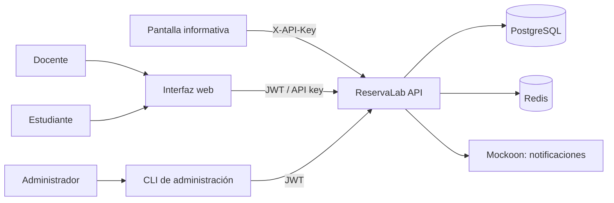
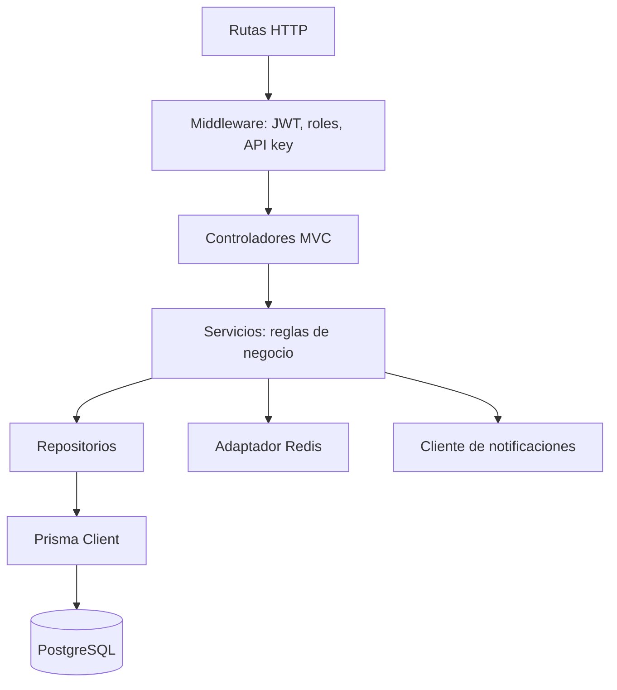
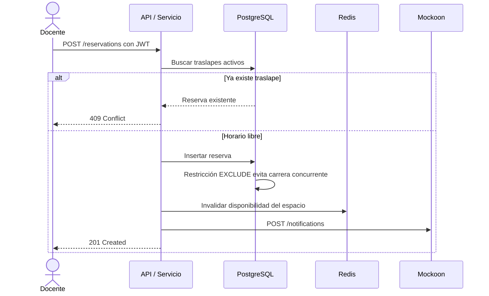

# Arquitectura de ReservaLab

## Propósito y alcance

ReservaLab permite a estudiantes consultar espacios y sus propias reservas, a docentes reservar espacios y a administradores gestionar espacios, horarios, usuarios y claves de integración. Una pantalla informativa consulta la ocupación actual con una API key. La API concentra las reglas de negocio; la web y el CLI son clientes sin acceso directo a PostgreSQL.

## Vista de contexto

## Vista de contenedores y paquetes

| Elemento | Tecnología | Responsabilidad |
|---|---|---|
| `apps/api` | Node.js, TypeScript, Express 5 | HTTP, auth, reglas de negocio y acceso a datos mediante capas |
| `apps/web` | HTML, CSS, TypeScript y Vite | Pantallas de login/reservas y ocupación informativa |
| `apps/cli` | Node.js y TypeScript | Herramienta de administrador para crear espacios y emitir API keys |
| `packages/shared` | TypeScript y Zod | Tipos y validación compartida entre API, web y CLI |
| PostgreSQL | PostgreSQL + Prisma ORM | Persistencia, migraciones y protección transaccional contra traslapes |
| Redis | Redis | Caché de 60 segundos e intervalo de solicitudes por API key |
| Mockoon | Mockoon CLI | Simulación del servicio de notificaciones externo |

## Vista de componentes de la API

Una solicitud pasa por ruta, middleware, controlador, servicio y repositorio. El controlador no conoce el ORM; el repositorio no conoce HTTP.

## Secuencia de reserva

## Atributos de calidad y medidas

| Atributo | Medida objetivo | Mecanismo |
|---|---|---|
| Integridad de reservas | 0 traslapes activos para un espacio | Validación en servicio y exclusión GiST de PostgreSQL usando `btree_gist` |
| Seguridad de contraseña | Nunca guardar contraseña en texto plano | bcrypt con factor de trabajo 12 |
| Duración de access token | 15 minutos | JWT de acceso firmado |
| Duración de refresh token | 7 días y revocable | Hash en DB y rotación al renovar |
| Respuesta de lectura repetida | TTL de caché de 60 segundos | Redis; `X-Cache: HIT/MISS` |
| Protección de API key | Máximo 60 solicitudes por minuto por clave | Contador Redis con ventana de 60 s |
| Reservas dentro de horario | Toda reserva activa cae dentro de un bloque habilitado | Horarios semanales por espacio, validados en el servicio |
| Disponibilidad operativa | Todos los componentes iniciables con Compose | Health check para PostgreSQL, Redis y API |
| Pruebas | Cobertura de código de 70 % o más | Pruebas unitarias e integración de rutas críticas |

## Decisiones de arquitectura

- Se usa un monolito modular dentro del monorepo porque el proyecto se entrega como un sistema pequeño y el flujo exige iniciar todo con una sola instrucción.
- Las reglas de negocio permanecen en servicios, con repositorios detrás del ORM para facilitar mocks y pruebas unitarias.
- Las validaciones de entrada se comparten con Zod desde `packages/shared` para reducir diferencias entre clientes y API.
- Las reservas canceladas se conservan como historial y dejan de participar en la restricción de traslape.
- Los horarios disponibles son recurrentes por día de semana, en la hora local de Guatemala; el seed crea horarios de demostración de 07:00 a 22:00 todos los días.
- `docs/adr/` registra alternativas y razones de decisiones técnicas.
